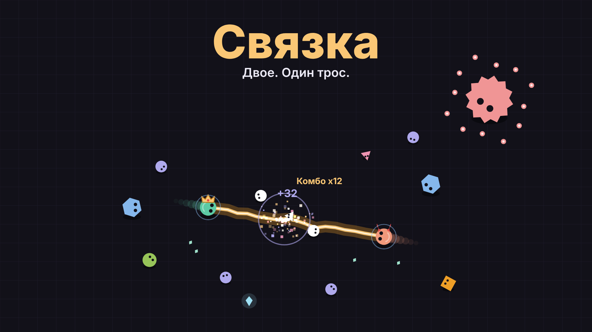
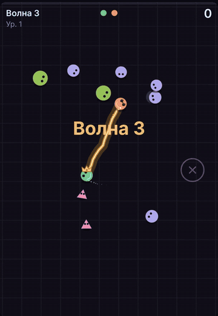
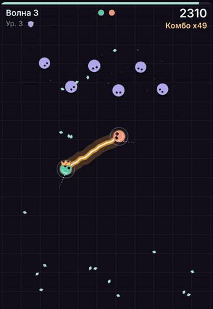
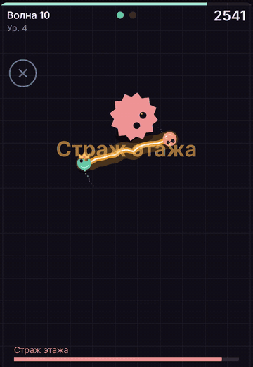
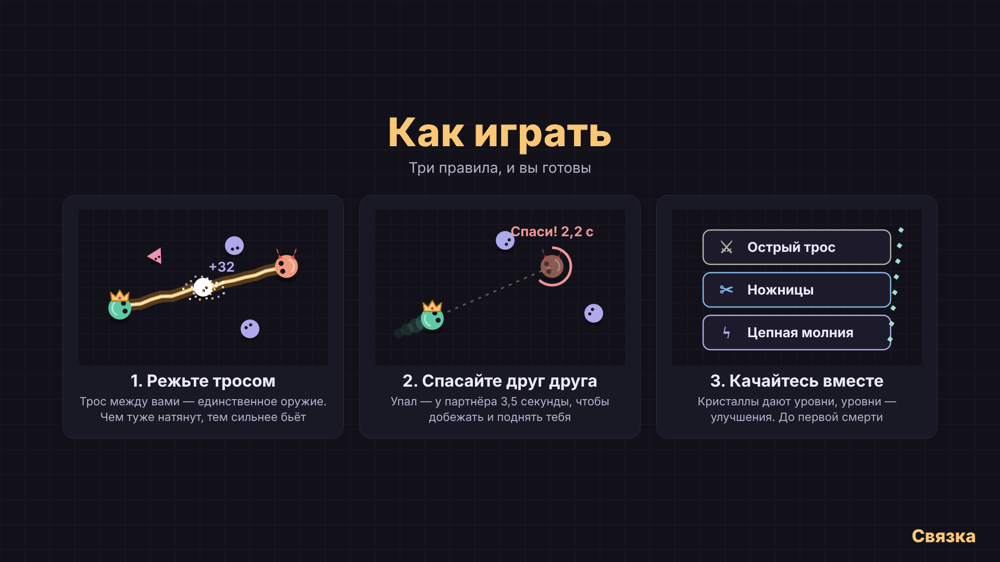
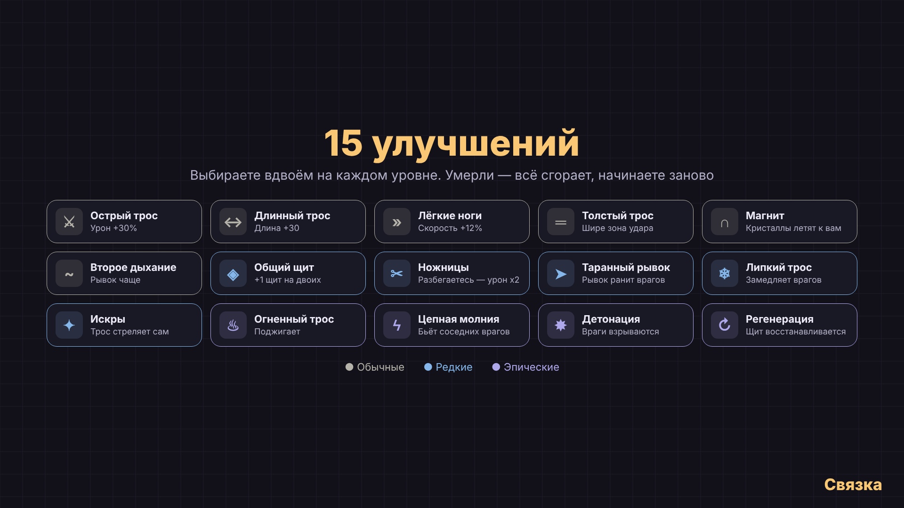
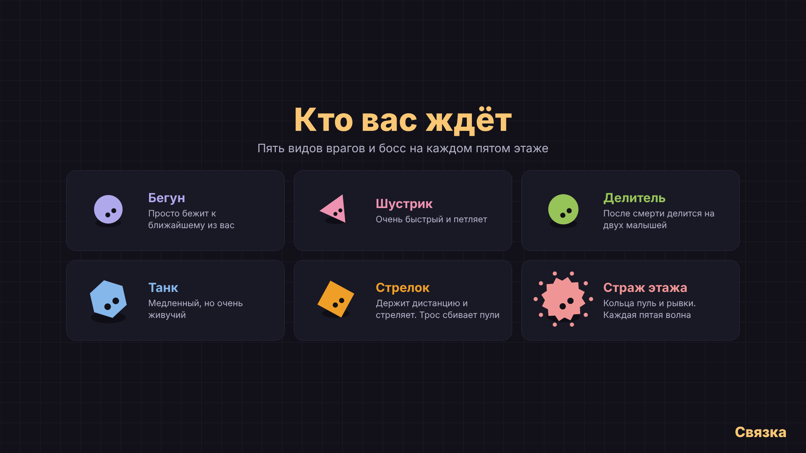
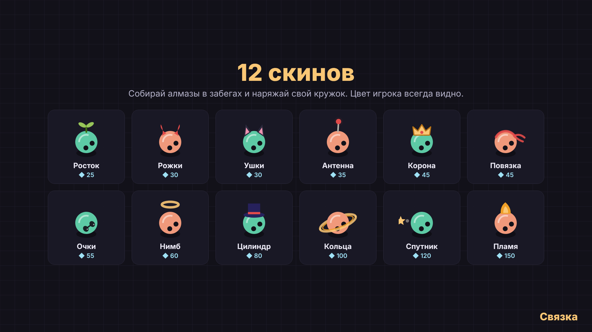

<p align="center"></p>

<p align="center">
  <b>Кооперативный роглайт на двоих в одном HTML-файле.</b><br>
  Вас соединяет трос: он режет врагов, сбивает пули и бьёт тем сильнее, чем туже натянут.
</p>

<p align="center">
  <a href="https://mor-game-studio.itch.io/tether-coop"><b>▶ Играть на itch.io</b></a> ·
  <a href="media/trailer.mp4">Трейлер</a> ·
  <a href="#english">English</a>
</p>

<p align="center">
  
  
  
</p>

## Об игре

| | |
|---|---|
| **Жанр** | кооперативный роглайт, top-down арена |
| **Игроки** | 2: на одном экране или онлайн |
| **Платформы** | браузер на телефоне и компьютере |
| **Языки** | русский, английский |
| **Размер** | один `index.html` около 80 КБ, без ассетов и сборки |

- Трос между игроками — единственное оружие. Урон зависит от натяжения, улучшение «Ножницы» удваивает его, когда игроки бегут в разные стороны.
- Если врага коснулся один из игроков, тот падает, а у партнёра есть 3,5 секунды, чтобы добежать и поднять его. Не успел — забег окончен.
- 15 улучшений трёх редкостей, 5 видов врагов, босс каждую пятую волну.
- Алмазы за волны и редкие алмазы на арене, магазин из 12 скинов. Скины рисуются поверх кружка и никогда не закрывают цвет игрока.
- Меню, настройки (громкость, тряска, вибрация, частицы, язык), отсчёт 3-2-1 перед первой волной.

<p align="center"></p>

## Техническая часть

Всё написано на чистом JavaScript без фреймворков и движков.

**Рендеринг.** Canvas 2D с фиксированной логической ареной 360×520, которая масштабируется под любой экран и DPR. Частицы с аддитивным смешиванием, тряска экрана, хит-стоп при убийстве крупных врагов, телеграфирование появления врагов и рывков босса.

**Звук.** Вся музыка и все эффекты синтезируются в реальном времени через Web Audio API: пошаговый секвенсор с басом, арпеджио и ударными, темп растёт с волной. В меню и на паузе музыка уходит под фильтр низких частот. Ни одного аудиофайла.

**Сетевой код.** Хост-авторитарная модель поверх WebRTC (PeerJS):
- хост симулирует игру и 20 раз в секунду рассылает компактные снимки состояния;
- визуальные события (взрывы, звуки, тексты) идут отдельным потоком, и каждый клиент воспроизводит их сам;
- гость отправляет только ввод, а его клиент сглаживает позиции интерполяцией;
- улучшения выбираются по очереди, отключение партнёра обрабатывается корректно.

**Список серверов без своего сервера.** Игра живёт на статическом хостинге, поэтому лобби сделано через 16 фиксированных идентификаторов на публичном сигнальном сервере PeerJS. Хост занимает первый свободный слот, а клиент опрашивает все слоты и получает от хостов название сервера и число игроков. Названия от других игроков экранируются.

**Локализация.** Словарь русских фраз → английских, перевод применяется при выводе. Поэтому по сети передаются ключи, а не готовый текст, и хост с гостем видят игру каждый на своём языке.

**Тестирование.** Для сети есть имитация PeerJS поверх `BroadcastChannel` (`?mocknet=1`): хост, гость и список серверов проверяются в нескольких вкладках одного браузера. Сценарии прогонялись в Playwright.

**Маркетинговые материалы тоже генерируются кодом** (папка [`tools/`](tools)):
- трейлер снят из самой игры: подменённые `performance.now` и `requestAnimationFrame` дают покадровую детерминированную съёмку, скриптованные сцены и подписи, кадры идут в ffmpeg;
- музыка к трейлеру синтезирована на NumPy;
- обложка, баннер и постеры нарисованы теми же функциями отрисовки, что и в игре.

<p align="center">
  
  
</p>
<p align="center"></p>

## Запуск

Открой `index.html` в браузере, и всё. Для онлайна нужен интернет: при запуске подгружается PeerJS с CDN.

| | Игрок 1 | Игрок 2 |
|---|---|---|
| Телефон | левый джойстик, тап — рывок | правый джойстик, тап — рывок |
| Клавиатура | WASD + пробел | стрелки + Enter |

`P` или `Esc` — пауза. В онлайне у каждого игрока один джойстик на всю нижнюю зону.

## Структура

```
index.html      игра целиком: HTML, CSS, JS
media/          трейлер, GIF, обложка и постеры
tools/          скрипты, которыми сделаны трейлер, музыка и картинки
```

---

<a id="english"></a>

## English

**Svyazka (“Tether”)** is a co-op roguelite for two players, built as a single HTML file.
You and a friend are bound by an energy tether that slices enemies, blocks bullets and hits harder the tighter it’s pulled.
If one of you goes down, the other has 3.5 seconds to reach them. Too slow, and the run ends.

**Features:** local co-op on one screen (two on-screen joysticks or WASD + arrows), online co-op with a server list, 15 upgrades, 5 enemy types and a floor boss every fifth wave, diamonds and 12 cosmetic skins, settings, Russian and English UI.

**Tech highlights:**
- Vanilla JS + Canvas 2D, resolution-independent fixed arena.
- Fully procedural audio with the Web Audio API, no audio files.
- Host-authoritative netcode over WebRTC (PeerJS): 20 Hz state snapshots, a separate stream of visual events, interpolation on the guest.
- A serverless lobby: hosts claim one of 16 well-known peer IDs on the public PeerJS broker, and clients probe them to build the server list.
- Localization by translating at render time, so each player sees the game in their own language even online.
- A `BroadcastChannel`-based PeerJS mock (`?mocknet=1`) for testing multiplayer in browser tabs with Playwright.
- The trailer, cover and posters are generated from the game itself with Playwright, a virtual clock, ffmpeg and NumPy (see [`tools/`](tools)).

**Run:** open `index.html` in a browser. **Play online:** [itch.io](https://mor-game-studio.itch.io/tether-coop).

---

<p align="center">Сделано MOR Game Studio · <a href="LICENSE">MIT</a></p>
